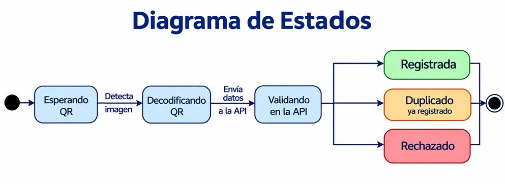

# AulaCheck

Sistema local de asistencia académica. Incluye una API FastAPI conectada a MySQL, una interfaz de escritorio para el docente hecha con PySide6, una app Flutter para que cada estudiante consulte y muestre su QR fijo, y una estación ESP32-CAM que lee esos QR por WiFi.

## Estado actual

- El docente puede crear clases, vincular estudiantes existentes, iniciar y finalizar sesiones, registrar asistencia manual, consultar el historial y exportar un CSV.
- La app Flutter solicita el correo institucional a la API. Si ese correo está registrado, muestra el nombre y un QR fijo cuyo contenido es el correo.
- La estación ESP32-CAM está integrada: al pulsar **Iniciar asistencia**, la interfaz pide fotos a la cámara por WiFi, lee el QR con OpenCV, registra la asistencia en la API y enciende el LED verde, rojo o naranja de la estación. Ver [Estación ESP32-CAM](#estación-esp32-cam).
- El QR fijo se puede copiar. El prototipo no autentica que quien escribe el correo sea su dueño, así que no debe usarse como un mecanismo seguro de identidad.

## Componentes principales

| Ruta o archivo | Función |
|---|---|
| `main.py` | API FastAPI y reglas de clases, sesiones y asistencias. |
| `interfaz.py` | Aplicación de escritorio del docente, con el panel de la estación ESP32-CAM. |
| `estacion.py` | Lógica de la estación: pide fotos a la ESP32-CAM, lee el QR, consulta la API y elige el LED. |
| `firmware/aulacheck_cam/aulacheck_cam.ino` | Programa Arduino de la ESP32-CAM (cámara + WiFi + LED). |
| `tests/` | Pruebas automáticas de la estación (no necesitan MySQL ni la placa). |
| `database.py` | Conexión y sesiones de SQLAlchemy para MySQL. |
| `models.py` | Tablas y relaciones de la base de datos. |
| `schemas.py` | Formatos y validación de datos de la API. |
| `seed.py` | Carga estudiantes y una clase ficticia para pruebas. |
| `student_app/` | Aplicación móvil Flutter del estudiante. |
| `.env.example` | Plantilla de variables de conexión a MySQL. |
| `requirements.txt` | Dependencias de Python para backend e interfaz. |

## Requisitos

- Windows 10 u 11.
- Python 3.10 o posterior; se recomienda Python 3.12.
- MySQL Server iniciado. MySQL Workbench es opcional, pero facilita crear la base de datos.
- Flutter SDK estable y agregado a `PATH`.
- Android Studio con Android SDK, Android SDK Command-line Tools, Platform Tools y un emulador Android. Si el build solicita un NDK específico, instala la versión exacta indicada por el error desde **SDK Manager → SDK Tools → Show Package Details → NDK (Side by side)**.
- VS Code con las extensiones **Python**, **Pylance**, **Flutter** y **Dart**.

Comprueba las herramientas con:

```powershell
python --version
flutter --version
flutter doctor
```

Para Android, acepta las licencias si `flutter doctor` las solicita:

```powershell
flutter doctor --android-licenses
```

## Preparación inicial

Ejecuta estos pasos una sola vez desde la carpeta raíz del repositorio, donde está `main.py`.

### 1. Crear la base de datos

Inicia MySQL y ejecuta en MySQL Workbench o en otro cliente SQL:

```sql
CREATE DATABASE aulacheck
CHARACTER SET utf8mb4
COLLATE utf8mb4_unicode_ci;
```

Si la base ya existe, omite este paso.

### 2. Crear el entorno de Python e instalar dependencias

Abre una terminal de PowerShell en la raíz del repositorio:

```powershell
python -m venv .venv
.\.venv\Scripts\python.exe -m pip install --upgrade pip
.\.venv\Scripts\python.exe -m pip install -r requirements.txt
```

`requirements.txt` incluye FastAPI, SQLAlchemy, PyMySQL, PySide6, requests y OpenCV (versión `headless`, para que no choque con PySide6). No necesitas instalar nada por separado.

> Usa **Python 3.12** si `pip install` falla con tu versión. Si tienes varias versiones instaladas, crea el entorno con `py -3.12 -m venv .venv`.

### 3. Configurar MySQL

Copia la plantilla y edita las credenciales:

```powershell
Copy-Item .env.example .env
```

En `.env`, completa `DB_USER` y `DB_PASSWORD` con los datos de tu MySQL local. `ESP32_CAM_URL` es la dirección inicial de la cámara (se puede cambiar después desde la interfaz). El archivo `.env` está excluido de Git; no lo subas al repositorio.

### 4. Cargar datos ficticios (solo cuando sea necesario)

Con MySQL activo, desde la raíz del proyecto ejecuta:

```powershell
.\.venv\Scripts\python.exe seed.py
```

Esto crea tablas y agrega estudiantes de prueba y la clase de ejemplo con NRC `10001`. El script evita duplicar esos datos si vuelves a ejecutarlo. **No hace falta correr `seed.py` cada vez que inicias la aplicación.**

## Ejecutar toda la aplicación

Inicia MySQL primero. Después abre tres terminales de VS Code, todas en la carpeta raíz del proyecto, y deja abiertas las terminales de la API y de la interfaz.

### Terminal 1: API

```powershell
.\.venv\Scripts\python.exe -m uvicorn main:app --reload
```

La API queda en `http://127.0.0.1:8000`. Para comprobarla abre `http://127.0.0.1:8000/health`; la documentación interactiva está en `http://127.0.0.1:8000/docs`.

### Terminal 2: interfaz del docente

```powershell
.\.venv\Scripts\python.exe interfaz.py
```

La interfaz se conecta a `http://127.0.0.1:8000`, así que inicia la API antes de abrirla.

### Terminal 3: app del estudiante en Android

Primero inicia el emulador desde Android Studio (**Tools → Device Manager**, botón ▶). Confirma que Flutter lo detecte:

```powershell
cd student_app
flutter devices
```

En la primera ejecución o después de cambiar dependencias, instala los paquetes Flutter:

```powershell
flutter pub get
```

Luego inicia la app, reemplazando `emulator-5554` por el ID Android que muestre `flutter devices` si es distinto:

```powershell
flutter run -d emulator-5554
```

La app ya tiene configurada `http://10.0.2.2:8000` como dirección del backend para Android Emulator. `10.0.2.2` permite que el emulador llegue al computador anfitrión. El `AndroidManifest.xml` habilita HTTP sin cifrar para desarrollo local; para publicar la app se debe usar HTTPS y retirar esa excepción.

Si todavía no existe `student_app/android/`, genera una vez los archivos nativos desde `student_app/`:

```powershell
flutter create --platforms android .
```

Después revisa que `android/app/src/main/AndroidManifest.xml` tenga `android:usesCleartextTraffic="true"` dentro de `<application>` para que el emulador pueda consultar la API local por HTTP.

### Ejecutar en un teléfono Android físico (opcional)

Conecta el teléfono a la misma red Wi-Fi del computador y habilita la depuración USB. Inicia Uvicorn permitiendo conexiones de la red local:

```powershell
.\.venv\Scripts\python.exe -m uvicorn main:app --reload --host 0.0.0.0
```

Desde `student_app`, pasa la IP local del computador (reemplaza el ejemplo por la IP real):

```powershell
flutter run -d <ID_DEL_TELEFONO> --dart-define=API_BASE_URL=http://192.168.1.20:8000
```

Puede ser necesario permitir el puerto 8000 en el Firewall de Windows. Usa HTTP solo en la red local de desarrollo.

## Probar el flujo

1. Inicia MySQL, la API y la interfaz del docente.
2. Abre la app Flutter en el emulador.
3. Escribe un correo existente, por ejemplo `ana.martinez@utb.edu.co` si cargaste el seed.
4. Pulsa **Mostrar mi código**. La app debe consultar el perfil y presentar su QR.
5. Para probar un correo que no exista, espera el mensaje indicando que no está registrado.

La app móvil **solo muestra** el QR. La estación ESP32-CAM lo lee y la interfaz envía `{"email":"correo@universidad.edu.co"}` a `POST /sessions/{id}/attendance/scan` mientras la sesión está activa (ver la sección siguiente). El docente también puede registrar asistencia manualmente desde la interfaz.

## Estación ESP32-CAM

### Cómo funciona

```text
App Flutter (QR con el correo)
        │  el estudiante lo muestra a la cámara
        ▼
ESP32-CAM ──WiFi──► interfaz.py (PySide6) ──HTTP──► FastAPI ──► MySQL
   ▲  toma fotos        lee el QR con OpenCV        valida y registra
   └──────────── LED verde / rojo / naranja ◄──── resultado
```

La placa **no** lee el QR: solo toma fotos y enciende los LED. La interfaz del docente le pide una foto cada ~0,3 s mientras la sesión está activa, busca el QR con OpenCV y envía el correo a la API. Según la respuesta, le pide a la placa encender un LED. Si el mismo QR sigue frente a la cámara, se ignora durante 6 segundos para no registrarlo dos veces.

| LED | Cuándo | Lo que se ve en la interfaz |
|---|---|---|
| Verde | Asistencia válida, dentro de la tolerancia | «Presente» |
| Rojo | Fuera de tolerancia, correo no registrado, no matriculado, sesión cerrada, QR que no es un correo o API caída | El motivo exacto |
| Naranja | El estudiante ya tenía registro en esta sesión (no se crea otro) | «Ya registrado» |

El LED queda encendido 2 segundos. Con buzzer (opcional) suena un pitido corto en verde, uno largo en rojo y dos cortos en naranja.

### Diagrama de estados

El flujo de lectura, validación y respuesta de la estación se representa en el siguiente diagrama:



### 1. Cargar el firmware (una vez)

1. Instala **Arduino IDE 2.x**. En **Tools › Board › Boards Manager** instala **esp32 by Espressif Systems** (si la versión 3.x falla al descargar, la **2.0.17** funciona).
2. Abre `firmware/aulacheck_cam/aulacheck_cam.ino`.
3. Al inicio del archivo, en **CONFIGURACIÓN**, escribe el nombre y la clave de la red WiFi:
   ```cpp
   const char *WIFI_SSID = "NOMBRE_DE_LA_RED";
   const char *WIFI_PASSWORD = "CLAVE_DE_LA_RED";
   ```
   La red debe ser de **2,4 GHz** y con clave normal (WPA2 personal). Las redes con página de inicio de sesión o con usuario institucional **no funcionan**. El **punto de acceso del celular** es la opción más fácil; el computador debe estar conectado a esa misma red.
4. **Tools › Board › esp32 › AI Thinker ESP32-CAM** y **Tools › Port**: el COM de la base ESP32-CAM-MB.
5. **Upload**. Si se queda en `Connecting....`, mantén **IO0**, pulsa **RST** y suelta IO0.
6. Abre **Tools › Serial Monitor** a **115200** baudios y pulsa **RST**. Debe aparecer:
   ```text
   Cámara lista (640x480, PSRAM).
   WiFi conectado.
     Dirección para la interfaz: http://192.168.43.120
   ```
   Esa dirección es la que se escribe en la interfaz. Al arrancar, los tres LED se encienden un instante.

Para comprobar la cámara sin la interfaz, abre esa dirección en el navegador del computador: hay una página con la vista en vivo y botones para probar cada LED.

### 2. Conectar los LED (protoboard)

| LED | Pin de la ESP32-CAM | Conexión |
|---|---|---|
| Verde | GPIO 13 | GPIO → resistencia 220 Ω → pata larga del LED; pata corta → GND |
| Rojo | GPIO 14 | igual |
| Naranja | GPIO 15 | igual |

Los pines se pueden cambiar en la sección **CONFIGURACIÓN** del `.ino` (`LED_VERDE_PIN`, `LED_ROJO_PIN`, `LED_NARANJA_PIN`). El buzzer está desactivado (`BUZZER_PIN -1`); para usarlo, poner `2` y conectarlo mediante un transistor. No uses la ranura microSD: comparte esos pines.

### 3. Usar la estación

1. Inicia MySQL, la API (Terminal 1) y la interfaz (Terminal 2) como se explicó arriba.
2. En el **Panel de asistencia**, escribe la dirección de la cámara en el panel **ESTACIÓN ESP32-CAM** (por ejemplo `192.168.43.120`) y pulsa **Probar**: debe aparecer una foto y «Cámara lista». La dirección se recuerda para la próxima vez.
3. **Probar LED** enciende los tres LED uno por uno; **Flash** prende el LED blanco de la placa si hay poca luz (en pantallas de celular suele causar reflejos).
4. Pulsa **Iniciar asistencia**. La estación empieza a leer: la vista en vivo se actualiza y cada lectura aparece en **ÚLTIMA LECTURA** y en la tabla.
5. **Finalizar clase** detiene la lectura y apaga los LED.

**Distancia recomendada:** el QR del celular a unos 15–30 cm de la cámara, con el brillo de la pantalla alto y sin reflejos.

**Ojo con la tolerancia al probar:** la API compara la hora del registro con la **hora de inicio de la clase** + la tolerancia. La clase del `seed.py` empieza a las 08:00 con 10 min, así que si pruebas en otra hora el resultado será **rojo («Fuera de tolerancia»)**. Para probar el verde, crea en **Gestión de clases** una clase que empiece a la hora actual, vincula estudiantes y usa esa.

### Problemas frecuentes de la estación

| Síntoma | Causa probable | Solución |
|---|---|---|
| El Serial Monitor muestra puntos y «No se pudo conectar al WiFi» | Nombre o clave mal escritos, red de 5 GHz o red institucional con inicio de sesión | Revisa `WIFI_SSID`/`WIFI_PASSWORD`; usa el punto de acceso del celular en 2,4 GHz |
| «Sin conexión con la cámara · reintentando» en la interfaz | IP incorrecta o el computador está en otra red | Copia la IP del Serial Monitor; conecta el PC a la misma red que la placa. Pasa el mouse sobre el mensaje para ver el detalle |
| «La placa responde, pero la cámara no inició» | Cable plano de la cámara suelto | Revisa el conector de la OV2640 y pulsa RST |
| `esp_camera.h: No such file or directory` al compilar | La placa elegida no es una ESP32 | Instala **esp32 by Espressif** y elige **AI Thinker ESP32-CAM** |
| La vista funciona pero nunca lee el QR | QR pequeño, lejos, desenfocado o con reflejos | Acércalo (que ocupe ~¼ de la imagen), sube el brillo del celular, inclínalo un poco |
| Siempre sale rojo «Fuera de tolerancia» | La clase empezó hace más que la tolerancia | Usa una clase que empiece a la hora actual (ver arriba) |
| La placa se reinicia sola | Alimentación insuficiente | Usa un cable USB corto y un puerto directo del PC o un cargador de 5 V / 2 A |

## Pruebas automáticas

Las pruebas usan una base SQLite temporal y una ESP32-CAM simulada, así que no necesitan MySQL ni la placa:

```powershell
.\.venv\Scripts\python.exe -m pip install -r requirements-dev.txt
.\.venv\Scripts\python.exe -m pytest
```

Cubren la lectura del QR en fotos de distintos tamaños, cada color de LED según la respuesta de la API, la espera para no registrar dos veces el mismo QR y la comunicación con la cámara.

## Endpoints principales

| Método | Ruta | Función |
|---|---|---|
| `GET` | `/health` | Verificar que la API responde. |
| `GET` | `/students/by-email/{email}` | Consultar un estudiante por correo. |
| `GET` | `/classes` | Listar clases. |
| `POST` | `/classes` | Crear una clase y generar su NRC. |
| `GET` | `/classes/{nrc}` | Consultar una clase. |
| `PATCH` | `/classes/{nrc}/tolerance?tolerance_minutes=30` | Cambiar la tolerancia. |
| `POST` | `/classes/{nrc}/students` | Vincular un estudiante existente a una clase. |
| `GET` | `/classes/{nrc}/students` | Listar estudiantes de una clase. |
| `POST` | `/classes/{nrc}/sessions/start` | Iniciar una sesión. |
| `POST` | `/sessions/{id}/attendance/scan` | Registrar un intento QR enviado por un lector. |
| `POST` | `/sessions/{id}/attendance/manual` | Registrar asistencia manual. |
| `GET` | `/sessions/{id}/attendance` | Consultar los registros de una sesión. |
| `POST` | `/sessions/{id}/finish` | Finalizar una sesión y marcar ausencias. |
| `GET` | `/sessions?nrc=10001` | Consultar sesiones, opcionalmente por clase. |

## Solución de problemas

- **`python` o `.venv` no se reconoce:** confirma que la terminal está en la raíz (donde existe `main.py`) y que ya ejecutaste `python -m venv .venv`.
- **Error de MySQL o `Access denied`:** verifica que el servicio MySQL esté iniciado y revisa `DB_HOST`, `DB_PORT`, `DB_NAME`, `DB_USER` y `DB_PASSWORD` en `.env`.
- **La interfaz no conecta:** comprueba que Uvicorn siga activo y que `http://127.0.0.1:8000/health` abra en el computador.
- **El emulador no aparece:** abre el emulador en Android Studio y verifica con `flutter devices`; debe aparecer como Android y estar en línea.
- **La app Flutter no conecta:** abre `http://10.0.2.2:8000/health` en el navegador del emulador, comprueba que Uvicorn esté activo y verifica `android:usesCleartextTraffic="true"` dentro de `<application>` en el manifiesto Android principal.
- **Gradle dice que falta un NDK:** instala en Android Studio la versión exacta que aparece en el error desde **SDK Manager → SDK Tools → Show Package Details → NDK (Side by side)**.

## Seguridad y limitaciones

Este proyecto es un prototipo para desarrollo local y pruebas académicas. No uses contraseñas reales en archivos versionados ni expongas el servidor de desarrollo a Internet. El QR fijo contiene el correo institucional y puede copiarse; la consulta del correo no equivale a iniciar sesión ni autentica la identidad del estudiante. La clave del WiFi queda escrita en el `.ino`: no subas al repositorio el archivo con la clave real. La ESP32-CAM no pide contraseña: cualquiera en la misma red puede ver la cámara y encender los LED, así que úsala solo en una red de confianza. La autenticación y la conexión segura HTTPS están pendientes.
